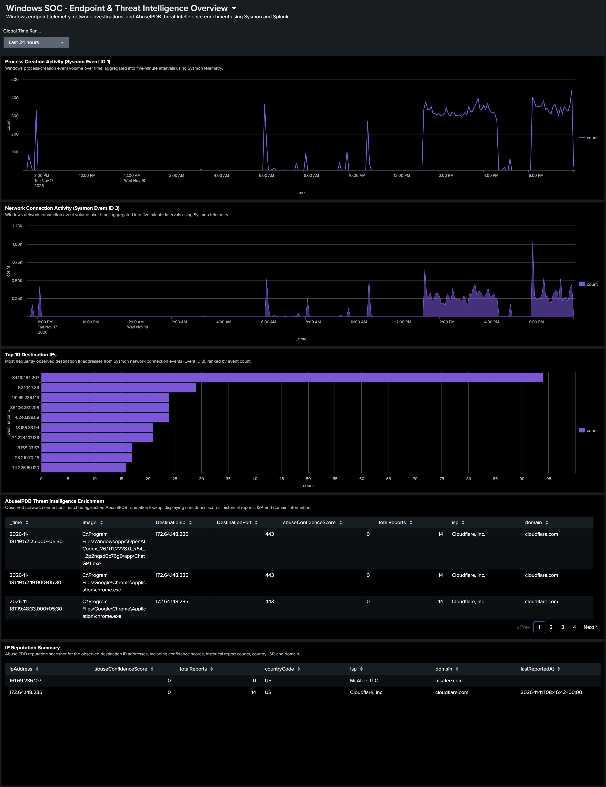
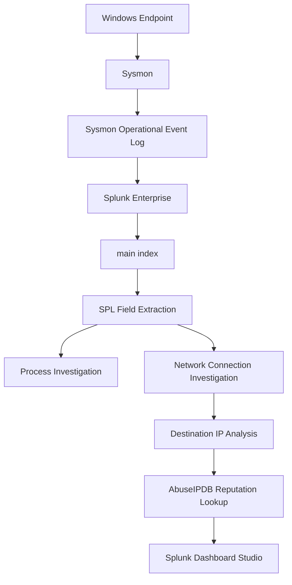

# Windows SOC Lab: Sysmon + Splunk Investigation & Threat Intelligence



A hands-on Windows Security Operations Center (SOC) home lab focused on endpoint telemetry collection, network investigation, SIEM query development, threat-intelligence enrichment, and security dashboard development using Sysmon and Splunk Enterprise.

## Project Overview

This project demonstrates a practical Windows security monitoring workflow:

1. Configure Sysmon to collect process and network telemetry.
2. Collect Sysmon Operational events in Splunk.
3. Extract useful fields from XML-formatted event data using SPL.
4. Investigate process creation and network connections.
5. Analyze destination IP addresses and connection activity.
6. Enrich observed IP addresses using AbuseIPDB reputation data.
7. Build and validate investigation queries.
8. Create a five-panel Splunk Dashboard Studio dashboard.
9. Preserve screenshots and supporting evidence.

## Lab Environment

| Component | Configuration |
|---|---|
| Endpoint | Windows desktop |
| Telemetry source | Microsoft Sysmon |
| Sysmon configuration schema | 4.91 |
| SIEM | Splunk Enterprise 9.3.14 |
| Splunk Web | `http://127.0.0.1:8001` |
| Event channel | `Microsoft-Windows-Sysmon/Operational` |
| Splunk index | `main` |
| Event format | XML |
| Query language | Splunk Processing Language (SPL) |
| Threat intelligence | AbuseIPDB API v2 |
| Dashboard | Splunk Dashboard Studio |

The lab uses a local Windows environment. No virtual machines or separate Linux attacker systems are required for the work documented here.

## Architecture



## Verified Work

### 1. Sysmon Endpoint Telemetry

- Installed Sysmon and applied a configuration using schema version 4.91.
- Verified that the Sysmon service was running.
- Confirmed that the Sysmon Operational event channel was enabled.
- Captured process creation events (Event ID 1).
- Captured network connection events (Event ID 3).
- Used Notepad and Windows PowerShell as harmless process-creation test cases.
- Observed actual Windows network connection activity.

### 2. Splunk Event Collection

Configured Splunk to collect:

`Microsoft-Windows-Sysmon/Operational`

The following input configuration was used:

```ini
[WinEventLog://Microsoft-Windows-Sysmon/Operational]
disabled = 0
index = main
renderXml = 1
```

Verified that Sysmon events were searchable in the `main` index.

### 3. SPL Investigation and Network Analysis

Used `rex` to extract fields from raw XML event data.

Validated investigations include:

| Investigation | Purpose | Validation |
|---|---|---|
| Sysmon Process Creation - Notepad | Extract process image, parent image, process ID | Tested successfully |
| Windows PowerShell Process Creation | Identify PowerShell process creation and parent process | Tested successfully |
| Network Connection Field Extraction | Extract process, protocol, source IP, destination IP, and destination port | Tested successfully |
| Network Destination Analysis | Rank destination IP addresses by observed event count | Tested successfully |
| AbuseIPDB Threat Intelligence Enrichment | Match observed destination IPs against reputation lookup data | Tested successfully |

The tested SPL queries are maintained in:

`detections/splunk-queries.spl`

### 4. Threat Intelligence Enrichment

Integrated AbuseIPDB reputation information with observed Sysmon network connection events.

The enrichment workflow:

1. Selected observed destination IP addresses from Sysmon Event ID 3 telemetry.
2. Queried the AbuseIPDB API v2.
3. Recorded reputation results in `lookups/abuseipdb-enrichment.csv`.
4. Configured the CSV as a Splunk lookup table.
5. Used SPL `lookup` to enrich matching network events.
6. Validated the resulting enriched events in Splunk.

Two observed IP addresses were assessed:

| IP address | Abuse confidence score | Historical reports | ISP |
|---|---:|---:|---|
| 161.69.236.107 | 0 | 0 | McAfee, LLC |
| 172.64.148.235 | 0 | 14 | Cloudflare, Inc. |

These are point-in-time reputation results. Historical reports do not establish that the observed connection was malicious. Shared infrastructure, hosting providers, and content delivery networks require additional context during investigation.

The API key is not included in the repository or lookup CSV.

### 5. Splunk Dashboard Studio

Created and saved the dashboard:

**Windows SOC - Endpoint & Threat Intelligence Overview**

The dashboard contains five panels:

| Panel | Visualization | Data |
|---|---|---|
| Process Creation Activity | Line chart | Sysmon Event ID 1 |
| Network Connection Activity | Area chart | Sysmon Event ID 3 |
| Top 10 Destination IPs | Bar chart | Destination IP frequency |
| AbuseIPDB Threat Intelligence Enrichment | Table | Enriched network events |
| IP Reputation Summary | Table | AbuseIPDB lookup records |

All five panels were visible in the saved dashboard view.

### 6. Investigation Observations

The lab produced the following observations:

- Notepad process creation events were captured by Sysmon.
- Windows PowerShell process creation events were captured.
- Parent process information was available for investigation.
- Network connection events included destination IP and port information.
- Splunk background process activity was observed during investigation.
- Two observed public IP addresses were enriched with AbuseIPDB reputation information.

These observations establish telemetry collection, investigation, and enrichment capability. They do not represent confirmed malicious activity or a successful threat detection.

## Investigation Query Status

The SPL query file contains investigation queries tested against collected lab data.

The documented work focuses on telemetry analysis, investigation, and reputation enrichment. A reputation match or high event count alone is not treated as a confirmed security detection.

Do not interpret an untested reference query as a functioning detection.

## Evidence

Screenshots and supporting evidence are maintained in [`docs/screenshots/`](docs/screenshots/README.md).

| Evidence | Description |
|---|---|
| `00-splunk-search-verification.png` | Successful Splunk search |
| `01-sysmon-notepad-event-redacted.txt` | Redacted raw Notepad Sysmon event |
| `02-sysmon-process-creation-splunk.png` | Notepad process investigation |
| `03-powershell-process-creation-splunk.png` | PowerShell process investigation |
| `04-powershell-query-validation.png` | PowerShell SPL query validation |
| `05-network-destination-analysis.png` | Network destination analysis |
| `06-abuseipdb-enrichment-splunk.png` | AbuseIPDB enrichment results |
| `07-windows-soc-threat-intelligence-dashboard.png` | Five-panel Splunk dashboard |

## Repository Structure

```text
.
|-- configs/
|   `-- sysmon/
|       `-- sysmonconfig.xml
|-- dashboards/
|   `-- dashboard_specs.md
|-- detections/
|   `-- splunk-queries.spl
|-- docs/
|   |-- architecture.md
|   |-- attack-simulation-guide.md
|   |-- deployment-guide.md
|   |-- lab-execution-log.md
|   |-- tuning-and-engineering.md
|   `-- screenshots/
|       |-- README.md
|       |-- 00-splunk-search-verification.png
|       |-- 01-sysmon-notepad-event-redacted.txt
|       |-- 02-sysmon-process-creation-splunk.png
|       |-- 03-powershell-process-creation-splunk.png
|       |-- 04-powershell-query-validation.png
|       |-- 05-network-destination-analysis.png
|       |-- 06-abuseipdb-enrichment-splunk.png
|       `-- 07-windows-soc-threat-intelligence-dashboard.png
|-- lookups/
|   `-- abuseipdb-enrichment.csv
|-- .gitattributes
|-- .gitignore
|-- LICENSE
`-- README.md
```

## Current Scope and Future Work

Potential future development areas include:

- Additional Sysmon event types and investigations.
- PowerShell command-line analysis.
- Detection logic development and validation.
- Alert creation and testing.
- Automated threat-intelligence refresh.
- False-positive investigation and tuning.
- Additional reputation sources and enrichment context.

Future capabilities will be documented as completed only after implementation and testing.

## License

This project is licensed under the MIT License. See [LICENSE](LICENSE).

